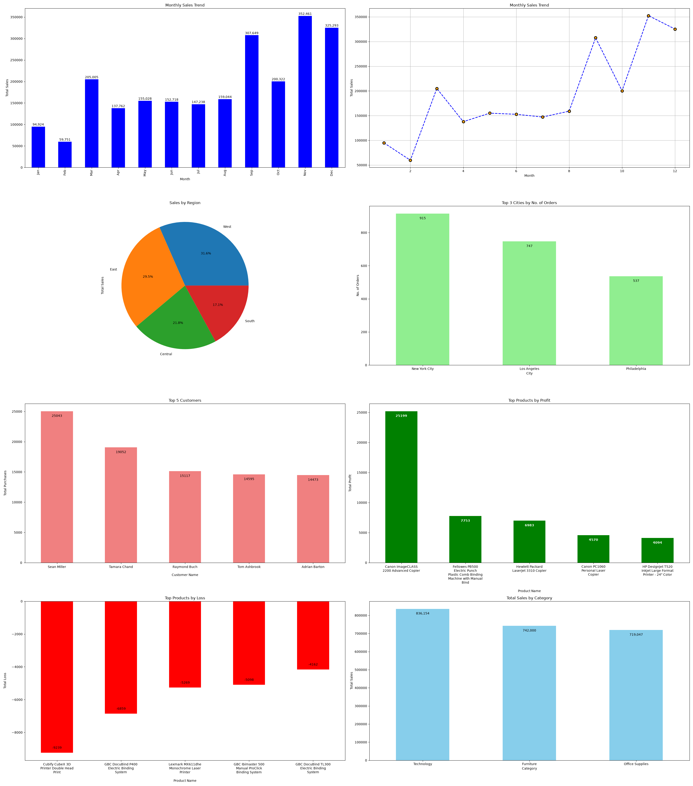

# 🛒 Superstore Sales Analysis — Exploratory Data Analysis (EDA)

A complete end-to-end **Exploratory Data Analysis (EDA)** project on the popular Superstore retail dataset using **Python, Pandas, and Matplotlib**. This project analyzes 9,994 sales transactions to uncover business insights around sales trends, profitability, regional performance, and customer behavior.

---

## 📊 Dashboard Preview



---

## 🎯 Project Objectives

- Understand **sales and profit distribution** across product categories, regions, and cities.
- Identify **top-performing and loss-making products** to support business decisions.
- Analyze **monthly sales trends** to detect seasonal patterns.
- Find **high-value customers** contributing the most to total revenue.
- Practice real-world **data cleaning, aggregation, and visualization** techniques.

---

## 📂 Project Structure

```
superstore/
│
├── working.ipynb          # Main Jupyter Notebook with all analysis and charts
├── Superstore.csv         # Raw dataset (9,994 rows × 21 columns)
├── sales_analysis.png     # Exported dashboard image (8 charts)
└── README.md              # Project documentation
```

---

## 🔍 Dataset Overview

| Property | Details |
| :--- | :--- |
| **Source** | Superstore Sales Dataset (publicly available) |
| **Rows** | 9,994 |
| **Columns** | 21 |
| **Time Period** | 2014 – 2017 |
| **Key Columns** | Order Date, Category, Region, City, Customer Name, Product Name, Sales, Profit, Discount |

---

## 🧹 Data Cleaning Steps

- Loaded dataset with correct `ISO-8859-1` encoding to handle special characters.
- Verified **zero missing values** across all 21 columns.
- Confirmed **zero duplicate rows**.
- Converted `Order Date` and `Ship Date` columns from string to `datetime` format using `pd.to_datetime()`.
- Extracted `Month` from `Order Date` for time-series analysis.

---

## 📈 Analysis & Key Insights

### 1. 🗂️ Sales by Category
- **Technology** is the highest revenue category: **$836,154**
- Furniture follows at **$742,000**
- Office Supplies generates **$719,047**

### 2. 🌍 Sales by Region
- **West** dominates with **31.6%** of total sales
- **South** has the lowest share at **11.2%**

### 3. 🏙️ Top 3 Cities by Number of Orders
| City | Orders |
| :--- | :--- |
| New York City | 915 |
| Los Angeles | 747 |
| Philadelphia | 537 |

### 4. 👤 Top 5 Customers by Total Purchases
| Customer | Total Purchases |
| :--- | :--- |
| Sean Miller | $25,043 |
| Tamara Chand | $19,052 |
| Raymond Buch | $15,117 |
| Tom Ashbrook | $14,595 |
| Adrian Barton | $14,473 |

### 5. ✅ Top Products by Profit
- **Canon ImageCLASS 2200 Advanced Copier** — Highest profit: **$25,199**
- **Fellowes PB500 Electric Punch** — **$7,753**
- **Hewlett Packard LaserJet 3310 Copier** — **$6,983**

### 6. ❌ Top Products by Loss
- **Cubify CubeX 3D Printer** — Largest loss: **-$8,880**
- **GBC DocuBind P400** — **-$5,804**
- **Lexmark MX611** — **-$4,545**

### 7. 📅 Monthly Sales Trend
- **November** is the peak sales month: **$352,461**
- **February** has the lowest sales: **$59,751**
- Clear **Q4 seasonality** — sales spike from September through December.

---

## 📊 Visualizations (8 Charts)

| # | Chart | Type | Insight |
| :--- | :--- | :--- | :--- |
| 1 | Monthly Sales Trend | Bar Chart | Seasonal sales pattern across 12 months |
| 2 | Monthly Sales Trend | Line Chart | Trend direction and inflection points |
| 3 | Sales by Region | Pie Chart | Regional sales share breakdown |
| 4 | Top 3 Cities by Orders | Bar Chart | City-wise order volume |
| 5 | Top 5 Customers | Bar Chart | High-value customer identification |
| 6 | Top Products by Profit | Bar Chart | Best-performing products |
| 7 | Top Products by Loss | Bar Chart | Loss-making products for business review |
| 8 | Total Sales by Category | Bar Chart | Revenue comparison across categories |

---

## 🛠️ Tech Stack

| Tool | Purpose |
| :--- | :--- |
| **Python 3.x** | Core programming language |
| **Pandas** | Data loading, cleaning, and aggregation |
| **NumPy** | Numerical operations |
| **Matplotlib** | Data visualization and charting |
| **Jupyter Notebook** | Interactive development environment |

---

## 🚀 How to Run This Project

**1. Clone the repository:**
```bash
git clone https://github.com/your-username/superstore-eda.git
cd superstore-eda
```

**2. Install dependencies:**
```bash
pip install pandas numpy matplotlib jupyter
```

**3. Launch the Jupyter Notebook:**
```bash
jupyter notebook working.ipynb
```

**4. Run all cells** from top to bottom to reproduce the full analysis and dashboard.

---

## 💡 Key Python Concepts Demonstrated

- `pd.read_csv()` with encoding handling
- `df.info()`, `df.describe()`, `df.isnull().sum()` for data health checks
- `df.groupby().sum()` and `.sort_values()` for aggregation
- `df.value_counts()` for frequency analysis
- `df['col'].dt.month` for datetime feature extraction
- `plt.subplots()` for multi-chart dashboard layout
- `ax.bar_label()` for annotating chart bars with values
- `textwrap.fill()` for wrapping long product name labels
- `plt.savefig()` for exporting charts as images

---

## 📌 Business Recommendations Based on Analysis

1. **Discontinue or reprice** the Cubify CubeX 3D Printer — it generates the highest loss of **$8,880**.
2. **Focus marketing in the West region** — it generates 31.6% of revenue but may have untapped potential in the South (11.2%).
3. **Stock up and run promotions in Q4** (Oct–Dec) — sales consistently peak in November at $352,461.
4. **Prioritize and reward top customers** like Sean Miller ($25,043) with loyalty programs to retain high-value accounts.

---

## 👤 Author

**Pratik**
- 📧 Connect on [LinkedIn](https://linkedin.com/in/your-profile)
- 💻 More projects on [GitHub](https://github.com/your-username)

---

## 📄 License

This project is open source and available under the [MIT License](LICENSE).
